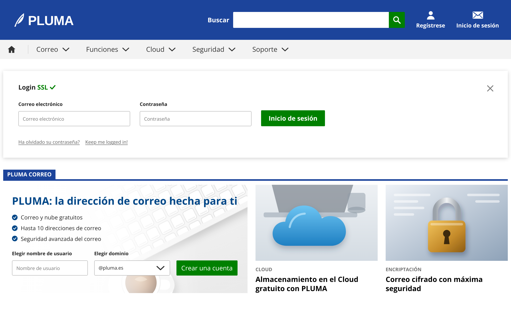
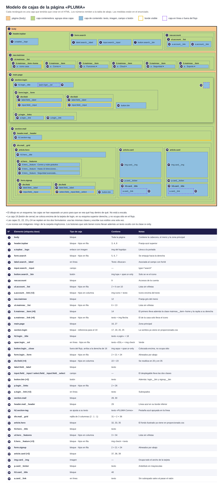

# Práctica · Portada del servicio de correo «PLUMA»

**Módulo:** Lenguajes de Marcas y Sistemas de Gestión de Información (LMSGI) · 1.º DAW
**Unidad:** UT01 · HTML y CSS
**Modalidad:** individual

---

## 1. Qué vas a construir

Vas a reproducir la portada de un servicio de correo electrónico ficticio llamado **PLUMA**. La página tiene una cabecera azul con buscador, un menú gris, una tarjeta de inicio de sesión y una sección con tres bloques de contenido.



> La captura está hecha con una ventana de **1280 px de ancho**. Todas las medidas de este enunciado se refieren a ese ancho.

Antes de escribir una sola línea, estudia el **modelo de cajas**. Ahí están todas las cajas que tienes que crear, con su número, su etiqueta y su clase:



Durante todo el enunciado, el número entre corchetes, por ejemplo **[16]**, remite a la caja con ese número en el modelo.

---

## 2. Material que te doy

```
pluma/
├── index.html            ← lo creas tú
├── css/
│   ├── variables.css      ← te lo doy (no lo toques)
│   ├── estilos.css        ← lo creas tú
│   └── proporcionado.css  ← te lo doy (no lo toques)
└── img/                   ← te la doy
    ├── logo-pluma.svg
    ├── hero-teclado.svg
    ├── nube.svg
    ├── candado.svg
    └── iconos/
        ├── buscar.svg   usuario.svg   sobre.svg   inicio.svg
        ├── flecha-abajo.svg   check.svg   check-circulo.svg
        └── cerrar.svg
```

### 2.1. `variables.css`: la paleta de colores

Los colores de la página ya están guardados como variables. **En tu `estilos.css` no puede aparecer ningún color escrito a mano**: usa siempre la variable, por ejemplo `var(--color-primario)`.

| Variable | Color | Dónde se usa |
|---|---|---|
| `--color-primario` | `#1c449b` | Fondo de la cabecera, pestaña «PLUMA CORREO» y su línea |
| `--color-titular` | `#004788` | Título grande de la portada |
| `--color-accion` | `#008000` | Botones verdes y texto «SSL» |
| `--color-accion-hover` | `#006400` | Botones verdes al pasar el ratón |
| `--color-texto` | `#222222` | Texto general y etiquetas de formulario |
| `--color-texto-menu` | `#333333` | Texto del menú gris |
| `--color-texto-fuerte` | `#000000` | Títulos de las tarjetas |
| `--color-texto-secundario` | `#5d5d5d` | Enlaces pequeños bajo el login |
| `--color-texto-apagado` | `#737373` | Antetítulos «CLOUD» y «ENCRIPTACIÓN» |
| `--color-texto-invertido` | `#ffffff` | Texto sobre fondo azul o verde |
| `--color-placeholder` | `#767676` | Texto de ayuda de los campos (ya aplicado) |
| `--color-fondo` | `#ffffff` | Fondo de la página y de la tarjeta de login |
| `--color-fondo-menu` | `#f3f3f3` | Franja gris del menú |
| `--color-borde-campo` | `#b4b4b4` | Borde de campos de texto y desplegable |
| `--color-borde-foco` | `#222222` | Borde del campo con el foco (ya aplicado) |
| `--color-separador` | `#d3d3d3` | Rayita vertical junto a la casa del menú |
| `--fuente-base` | Open Sans | Tipografía de toda la página |

### 2.2. `proporcionado.css`: lo que ya está hecho

Este archivo trae resueltas las partes que usan propiedades que todavía no hemos visto o que son poco habituales. **No tienes que escribirlas tú**, pero sí respetar los nombres de clase para que funcionen:

| Qué resuelve | Se aplica a la clase |
|---|---|
| Sombra de la tarjeta de login | `.login` |
| Fondo de la portada: ilustración del teclado con un velo blanco a la izquierda | `.hero` |
| Recorte de las imágenes de las tarjetas sin que se deformen | `.card__img` |
| Desplegable sin el aspecto del sistema y con la flecha propia | `.field__select` |
| Color del texto de ayuda (placeholder) | `.search__input`, `.field__input` |
| Aspecto del foco con el teclado (accesibilidad) | campos, enlaces y botones |
| Subrayado algo separado del texto | `.login__link` |
| Transición suave del color de los botones | `.btn`, `.search__btn` |
| Texto oculto que solo leen los lectores de pantalla | `.sr-only` |

### 2.3. Imágenes e iconos

Todas son SVG y se insertan con ``. Pon en cada `` su ancho y alto con los atributos `width` y `height`:

| Archivo | Tamaño | Dónde va | Texto alternativo |
|---|---|---|---|
| `logo-pluma.svg` | 156 × 40 | Logotipo [3] | «PLUMA, ir a la portada» |
| `iconos/buscar.svg` | 22 × 22 | Botón del buscador [7] | vacío (el botón lleva texto oculto) |
| `iconos/usuario.svg` | 24 × 24 | Acceso «Regístrese» [10] | vacío |
| `iconos/sobre.svg` | 28 × 24 | Acceso «Inicio de sesión» [10] | vacío |
| `iconos/inicio.svg` | 22 × 22 | Primer enlace del menú [14] | «Inicio» |
| `iconos/flecha-abajo.svg` | 22 × 22 | Resto de enlaces del menú [14] | vacío |
| `iconos/check.svg` | 16 × 16 | Junto a «SSL» [18] | vacío |
| `iconos/cerrar.svg` | 20 × 20 | Botón de cerrar [19] | vacío (el botón lleva texto oculto) |
| `iconos/check-circulo.svg` | 14 × 14 | Cada punto de la lista [34] | vacío |
| `nube.svg` | 300 × 187 | Primera tarjeta [37] | descríbela tú |
| `candado.svg` | 300 × 187 | Segunda tarjeta [37] | descríbela tú |
| `hero-teclado.svg` | — | Fondo de la portada (ya puesto en `proporcionado.css`) | — |

> **Regla del texto alternativo:** si el icono solo decora (porque al lado ya hay un texto que dice lo mismo), su texto alternativo va vacío. Si la imagen es lo único que explica el enlace o el botón, necesita texto.

---

## 3. Parte 1 · El HTML

1. Crea `index.html` con la estructura básica de un documento en español, con la codificación UTF-8, la etiqueta de *viewport* y el título `PLUMA · Correo electrónico gratuito`.
2. Enlaza la tipografía Open Sans de Google Fonts y después las tres hojas de estilo **en este orden exacto**:

   ```html
   <link rel="preconnect" href="https://fonts.googleapis.com">
   <link rel="preconnect" href="https://fonts.gstatic.com" crossorigin>
   <link rel="stylesheet" href="https://fonts.googleapis.com/css2?family=Open+Sans:wght@400;600;700&display=swap">
   <link rel="stylesheet" href="css/variables.css">
   <link rel="stylesheet" href="css/estilos.css">
   <link rel="stylesheet" href="css/proporcionado.css">
   ```

   `proporcionado.css` va el último para que sus reglas no se pisen con las tuyas.
3. Crea **todas** las cajas del modelo, con la etiqueta y la clase exactas que aparecen en la tabla. El orden de las cajas en el HTML es el orden en que aparecen en el modelo.
4. Los textos son los de la captura. La pestaña [29] se escribe en el HTML como `PLUMA Correo`; las mayúsculas las pondrás con CSS. Los antetítulos [38] se escriben `Cloud` y `Encriptación`, también en minúsculas.
5. Formularios:
   - Cada etiqueta `<label>` se asocia a su campo con `for` e `id`.
   - Elige el tipo de campo adecuado: búsqueda para el buscador, correo electrónico y contraseña para el login, texto para el nombre de usuario.
   - Los campos de texto muestran el texto de ayuda de la captura: «Correo electrónico», «Contraseña» y «Nombre de usuario».
   - El desplegable de dominio ofrece `@pluma.es`, `@pluma.com` y `@pluma.net`, y lleva las dos clases: `field__input` y `field__select`.
   - Los dos botones verdes [24] son de envío. El botón de cerrar [19] es un botón normal, que no envía nada.
6. Los botones que solo muestran un icono ([7] y [19]) llevan, además del ``, un `<span class="sr-only">` con su texto: «Buscar» y «Cerrar».
7. Los dos `<nav>` llevan un nombre accesible con `aria-label`: «Cuenta» y «Principal».
8. Antes de seguir, abre la página en el navegador **sin CSS** (comenta los enlaces a las hojas). Tiene que leerse en orden y entenderse.

---

## 4. Parte 2 · El CSS

Escribe todos tus estilos en `css/estilos.css`. Las indicaciones van por zonas, siguiendo los números del modelo. Cuando se dice «espacio interior» se habla del hueco entre el borde de una caja y su contenido. «Separación» o «margen» es el hueco hacia fuera, entre una caja y las de su alrededor. Cuando se dice «separación entre los hijos», es el hueco entre las cajas que hay dentro de un contenedor.

### 4.1. Reglas generales

- Todas las cajas de la página miden su ancho y su alto **incluyendo** el borde y el espacio interior.
- La página [1] no tiene margen exterior. Usa la tipografía base, con un tamaño de 14 px, una altura de línea de 1,4, el color de texto general y el fondo blanco.
- Todas las imágenes se comportan como cajas de bloque (así no dejan un hueco extraño debajo).
- Todas las listas de la página van sin viñetas, sin margen exterior y sin espacio interior.

### 4.2. Cabecera [2]

- Alto de 100 px y fondo con el color primario.
- Espacio interior de 30 px a izquierda y derecha.
- Sus hijos (logotipo, buscador y accesos) se colocan en fila y centrados en vertical.

**Buscador [4]**
- Hay que empujarlo hacia la derecha, de forma que todo el espacio libre de la cabecera quede a su izquierda.
- Sus tres hijos van en fila y centrados en vertical.
- La etiqueta «Buscar» [5] es blanca, en negrita, de 16 px, y está separada 10 px del campo.
- El campo [6] mide 390 px de ancho y 40 px de alto. No tiene borde, lleva un espacio interior de 12 px a los lados y redondea 2 px las dos esquinas de la izquierda. La letra la hereda de la página.
- El botón [7] es un cuadrado de 40 × 40 px, sin borde, con el fondo verde de acción y las dos esquinas de la derecha redondeadas 2 px. El icono va centrado en horizontal y en vertical. Al pasar el ratón el fondo cambia al verde de *hover*.

**Accesos de la cuenta [8] [9] [10]**
- La lista [9] está separada 28 px del buscador, y sus dos accesos van en fila separados 28 px entre sí.
- Cada acceso [10] muestra el icono encima del texto, los dos centrados y separados 4 px.
- El texto es blanco, en negrita y sin subrayado. Al pasar el ratón aparece el subrayado.

### 4.3. Menú gris [11]

- La franja ocupa todo el ancho y tiene el fondo gris del menú.
- La lista [12] mide 48 px de alto, tiene un espacio interior de 18 px a los lados y coloca sus elementos en fila, centrados en vertical.
- Cada enlace [14] pone su texto y su flecha en fila, centrados en vertical y separados 8 px. Tiene un espacio interior de 20 px a cada lado, de modo que entre dos enlaces quedan 40 px.
- El texto del menú mide 17 px, usa el color de texto del menú y va sin subrayado. Al pasar el ratón aparece el subrayado.
- El primer elemento, el de la casa (`mainnav__item--home`), tiene a su derecha una rayita vertical de 1 px con el color separador. Su enlace no tiene espacio interior a la izquierda y tiene 30 px a la derecha.

### 4.4. Zona principal [15]

- Ancho máximo de 1280 px, centrada en la ventana.
- Espacio interior de 30 px arriba, 8 px a los lados y 40 px abajo.

### 4.5. Tarjeta de login [16]

- Fondo blanco y espacio interior de 30 px arriba y abajo y de 38 px a los lados.
- Es la caja de referencia para colocar el botón de cerrar [19].
- **Título [17]:** 16 px y en negrita. No tiene margen arriba y está separado 24 px del formulario.
- **«SSL» [18]:** en el verde de acción. El texto y el check van en fila, centrados en vertical y separados 4 px.
- **Cerrar [19]:** se coloca encima de la tarjeta, a 34 px de su borde superior y a 34 px de su borde derecho, sin ocupar sitio en el flujo. Sin borde, sin fondo, sin espacio interior y con el cursor de mano.
- **Formulario [20]:** sus hijos van en fila, alineados por la parte de abajo y separados 24 px.
- **Enlaces [25]:** en fila, separados 14 px, con un tamaño de 12 px. El párrafo no tiene margen abajo y está separado 32 px del formulario. Los enlaces [26] usan el color de texto secundario y conservan el subrayado.

### 4.6. Campos de formulario [21] [22] [23]

Estas cajas se repiten en el login y en el alta. Escribe sus estilos **una sola vez**.

- Cada grupo [21] coloca la etiqueta encima del campo (hijos en columna).
- La etiqueta [22] mide 12 px, va en negrita y está separada 8 px del campo.
- El campo [23] mide 280 px de ancho y 38 px de alto, con un espacio interior de 10 px a los lados, borde de 1 px con el color de borde de campo y esquinas redondeadas 3 px. Hereda la letra de la página, pero a 12 px, y usa el color de texto general.

### 4.7. Botón verde [24]

Base común para los dos botones (`.btn`):
- Sin borde, esquinas redondeadas 2 px, fondo verde de acción y texto invertido.
- Hereda la tipografía de la página, a 16 px, con un espacio interior de 10 px a los lados.
- Al pasar el ratón, el fondo cambia al verde de *hover*.

Diferencias:
- El del login (`.login__btn`) mide 160 × 40 px y su texto va en negrita.
- El del alta (`.signup__btn`) mide 38 px de alto, lleva un espacio interior de 12 px a los lados y su texto nunca se parte en dos líneas.

### 4.8. Sección de correo [27]

- Separada 30 px de la tarjeta de login.
- **Cabecera [28]:** tiene en su parte inferior una línea de 4 px del color primario.
- **Pestaña [29]:** su ancho se ajusta a su texto. Sin márgenes, con un espacio interior de 10 px a los lados y una altura de línea de 24 px. Texto de 14 px, en negrita, en mayúsculas y con el color invertido sobre el fondo primario. Queda apoyada sobre la línea azul.
- **Rejilla [30]:** tres columnas en las que la primera ocupa el doble que cada una de las otras dos. Separación de 20 px entre columnas, y 10 px de separación con la línea azul de arriba.

### 4.9. Portada [31]

- Espacio interior de 24 px arriba y abajo y de 22 px a los lados. El fondo ya viene hecho.
- **Título [32]:** 26 px, negrita, altura de línea de 1,25 y color titular. Sin margen arriba y separado 16 px de la lista.
- **Lista [33]:** sus elementos van en columna, separados 7 px entre sí.
- **Cada punto [34]:** el icono y el texto van en fila, centrados en vertical y separados 8 px.
- **Formulario de alta [35]:** separado 20 px de la lista. Sus hijos van en fila, alineados por abajo y separados 16 px. Aquí los campos miden 190 px de ancho en lugar de 280 px.

### 4.10. Tarjetas [36]

- **Imagen [37]:** ocupa todo el ancho de la tarjeta, y su alto se calcula solo para que no se deforme.
- **Antetítulo [38]:** separado 14 px de la imagen y 4 px del título. Texto de 12 px, en negrita, en mayúsculas y con el color de texto apagado.
- **Título [39]:** sin márgenes, de 18 px, en negrita y con una altura de línea de 1,3.
- **Enlace del título [40]:** color de texto fuerte y sin subrayado. Al pasar el ratón aparece el subrayado.

---

## 5. Comprobación antes de entregar

- [ ] Todas las cajas del modelo existen, con la etiqueta y la clase exactas.
- [ ] El HTML pasa el validador del W3C sin errores.
- [ ] En `estilos.css` no hay ningún color escrito a mano: todos son variables.
- [ ] No has modificado `variables.css` ni `proporcionado.css`.
- [ ] Con la ventana a 1280 px, tu página coincide con la captura.
- [ ] Puedes recorrer toda la página con la tecla Tab y siempre se ve dónde está el foco.
- [ ] Cada `label` activa su campo al hacer clic sobre ella.
- [ ] Las herramientas de desarrollo (F12 → pestaña *Elementos* → panel del modelo de cajas) confirman las medidas que pide el enunciado.

## 6. Retos opcionales

1. **Ventanas estrechas:** por debajo de 900 px, la rejilla [30] pasa a una sola columna, los formularios [20] y [35] colocan sus campos uno debajo de otro y el buscador [4] se oculta.
2. **Cerrar de verdad:** investiga cómo ocultar la tarjeta de login al pulsar el aspa sin usar JavaScript (pista: `<details>` o `:target`).

## 7. Entrega

Comprime la carpeta `pluma/` completa en un `.zip` con el nombre `apellido1_nombre_pluma.zip` y súbela a la tarea del aula virtual.
